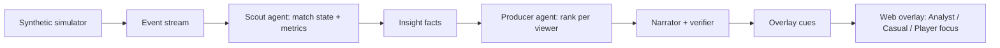

# Match Brain

**Explainable, personalized match intelligence built from synthetic football events.**

Football stories don't start and end with the scoreline. Match Brain takes a live stream of synthetic match events (passes, shots, tackles, pressure, possession changes) and turns it into insights that explain *why* a moment matters. It then shapes those insights for each viewer: a data-hungry analyst, a casual fan, or someone following a single player, in their own language.

This is an entry for the **Inside the Game: Developer Hackathon** (Microsoft × Premier League). All data is synthetic; no real Premier League match data is used.

> **Status:** the five-stage pipeline is implemented and demoable. Open `http://localhost:8000` after `python -m matchbrain`.

---

## Quick start

```bash
python3 -m venv .venv
source .venv/bin/activate
pip install -e ".[dev]"
cd web && npm install && npm run build && cd ..
python -m matchbrain
```

Then open [http://localhost:8000](http://localhost:8000). Click **Play demo**, jump to **60' Tanaka sent off**, then **89' Fujita winner**. Toggle **Split: analyst vs casual** to see the same fact as two different experiences.

One-command Docker:

```bash
docker compose up --build
```

Optional Azure AI Foundry / Azure OpenAI captions (templates always work without a key):

```bash
cp .env.example .env
# set AZURE_OPENAI_ENDPOINT, AZURE_OPENAI_API_KEY, AZURE_OPENAI_DEPLOYMENT
```

---

## What it does

The brief asks for one pipeline with five stages:

| Stage | What Match Brain does |
|---|---|
| **Ingest** | Replays a calibrated synthetic match as a timed WebSocket stream |
| **Interpret** | Live stats: pass difficulty, ball/shot speed, PPDA, Control vs Chaos, tempo |
| **Explain** | A numeric "why" on every key moment, e.g. *Win probability 3% → 98% (+95 pts)* |
| **Render** | Timed, machine-readable overlay cues a broadcast graphics system could display |
| **Personalize** | A Producer ranks insights per viewer: analyst vs casual, favourite club, player-focus, language |

### Example: the same moment, two experiences

The 89th-minute winner, as two viewers see it:

- **Casual fan (English):** *GOAL! E. Fujita scores for Riverside. Riverside are now 98% likely to win.*
- **Analyst (Japanese):** *ゴール E. Fujita（Riverside）89分 | 2-3 | xG 0.04 | 90 km/h | 勝利確率 3% → 98%（+95pt）*

Every number is checked against the underlying fact. A verifier rejects any sentence containing a number that is not backed by a recorded slot (try **Forge a 91% caption** in the UI).

---

## Architecture



**Core rule:** every insight is a structured, timestamped fact *before* it becomes text.

1. **Grounding** — the language model can only describe facts that exist.
2. **Broadcast-ready** — facts are timed JSON a graphics system can consume.
3. **Personalization** — one fact renders for any persona or language without recomputing analytics.

Contracts live in [`docs/ideation/schemas/`](docs/ideation/schemas/). Four studio agents share that blackboard: Scout, Producer, Narrator, Verifier.

### Microsoft technologies

| Use | Where |
|---|---|
| Azure AI Foundry / Azure OpenAI | Optional narrator and recap path (`AZURE_OPENAI_*`) |
| GitHub Models | Alternate Azure-hosted inference (`GITHUB_MODELS_TOKEN`) |
| GitHub | Public repo, Actions-ready layout, Copilot-assisted build |
| Azure Container Apps ready | `Dockerfile` + `docker compose` |

Live captions use templates first (microseconds, always grounded). Foundry/OpenAI only upgrades top moments and recaps, and the verifier still has the last word.

---

## Demo match

**Northbridge 2-3 Riverside** (`data/sample/demo_redcard_comeback.json`, seed 49). Northbridge lead 2-1, a red card at 61', then two late Riverside goals. The scoreline at 60' still says Northbridge are winning; the engine shows the press and control shift before the goals arrive.

| Minute | Moment |
|---|---|
| 18' | L. Ivanov (Riverside) |
| 21' / 26' | S. Brennan equalises, then 2-1 |
| 61' | T. Tanaka (Northbridge) sent off |
| 76' | D. Mensah equalises from a line-breaking through ball |
| 89' | **E. Fujita winner** — win probability 3% → 98% |

---

## Build roadmap

| # | Stage | Status |
|---|---|---|
| 0 | Project setup | Done |
| 1 | Simulator package | Done (`matchbrain/sim`) |
| 2 | Live ingest | Done (WebSocket replay) |
| 3 | Match state | Done |
| 4 | Metrics | Done (pass difficulty, speeds, PPDA, control, tempo) |
| 5 | Explain | Done (win probability + shift facts) |
| 6 | Producer | Done (explainable ranker per persona) |
| 7 | Narrator | Done (4 languages, verifier, optional Azure) |
| 8 | Overlay UI | Done (React + Vite broadcast client) |
| 9 | Video stub | Done (noisy detections → cleaner + precision/recall) |
| 10 | Package and demo | Done (`docker compose up`, model cards) |

---

## Tests

```bash
pip install -e ".[dev]"
pytest
```

Spikes that proved the hard parts still live in [`spikes/`](spikes/).

```bash
cd spikes
python3 spike_simulator.py
python3 spike_pass_difficulty.py
python3 spike_narrator.py
```

---

## Repository layout

```
matchbrain/     simulator, engine, narrator, studio agents, API
web/            React overlay replay
data/sample/    locked demo match
docs/ideation/  brief, schemas, architecture
docs/model-cards/
tests/
spikes/         original feasibility prototypes
```

## Tech stack

Python 3.12, FastAPI, WebSockets, numpy, scikit-learn; React and Vite for the overlay; Azure OpenAI / GitHub Models for optional narration.
