# Synthetic Match Insights Engine ("Match Brain")

**Explainable, personalized match intelligence built from synthetic football events.**

Football stories don't start and end with the scoreline. Match Brain takes a live stream of synthetic match events (passes, shots, tackles, pressure, possession changes) and turns it into insights that explain *why* a moment matters. It then shapes those insights for each viewer: a data-hungry analyst, a casual fan, or someone following a single player, in their own language.

This is my entry for the **Premier League Innovation Studio** hackathon, and a learning project in AI and data engineering. All data is synthetic; no real Premier League match data is used.

> **Status:** ideation and feasibility testing are complete. The build is starting. See the [roadmap](#build-roadmap) for progress.

---

## What it does

The brief asks for one pipeline with five stages. Here's how Match Brain covers each one:

| Stage | What Match Brain does |
|---|---|
| **Ingest** | Streams synthetic match events in real time from a calibrated match simulator |
| **Interpret** | Computes live statistics: pass difficulty, ball and shot speed, pressing intensity (PPDA), a Control vs Chaos index |
| **Explain** | Attaches a numeric "why" to every key moment, e.g. *"Win probability 3% -> 98% (+95 pts)"* |
| **Render** | Emits timed, machine-readable overlay cues that a broadcast graphics system could display |
| **Personalize** | A "Producer" ranks insights per viewer: analyst vs casual, favorite club, player-focus mode, language |

### Example: the same moment, two experiences

The 89th-minute winner in the demo match, as two different viewers see it:

- **Casual fan (English):** *GOAL! E. Fujita scores for Riverside. Riverside are now 98% likely to win.*
- **Analyst (Japanese):** *ゴール E. Fujita（Riverside）89分 | 2-3 | xG 0.04 | 90 km/h | 勝利確率 3% → 98%（+95pt）*

Every number in every caption is checked against the underlying data. A verifier rejects any sentence containing a number that isn't backed by a recorded fact.

---

## Architecture

```mermaid
flowchart LR
  Sim["Synthetic simulator"] --> Stream[Event stream]
  Stream --> State[Match state]
  State --> Metrics["Metrics: pass difficulty, speed, PPDA, control index"]
  Metrics --> Explain["Explain: win probability, shift detection"]
  Explain --> Facts[Insight facts]
  Facts --> Producer["Producer: ranks per viewer"]
  Producer --> Narrator["Narrator + verifier, multi-language"]
  Producer --> Cues[Overlay cues]
  Narrator --> Cues
  Cues --> UI["Web overlay: Analyst / Casual / Player focus"]
```



**The core design rule:** every insight is a structured, timestamped fact *before* it becomes text. That one rule does three jobs:

1. **Grounding:** the language model can only describe facts that exist, so it can't invent statistics.
2. **Broadcast-ready:** facts are already machine-readable and timed, so graphics systems can consume them directly.
3. **Personalization:** one fact can be rendered for any number of viewer profiles and languages without recomputing anything.

The three data contracts are defined as JSON Schemas in [`docs/ideation/schemas/`](docs/ideation/schemas/): match events, insight facts, and overlay cues.

---

## My process so far

I split the work into an ideation phase and a build phase. Ideation is about making the big decisions cheaply, before writing production code. Each step below has a write-up in [`docs/ideation/`](docs/ideation/).

### Step 1: Decode the brief
I turned the hackathon brief into a checklist of what judges will look for, and what "done" means for each item. The brief mentions "why it matters" in four places, so I decided explainability should be the signature feature.
→ [Brief checklist](docs/ideation/00-brief-checklist.md)

### Step 2: Score every topic
I scored each topic in the brief on three things: chance of winning, value for my AI and data engineering portfolio, and how much it costs to build in a weekend. That gave a clear build, stub, or cut decision for each. For example, generating events from real video scored well on impact but is far too risky for a weekend, so it becomes a simulated stub.
→ [Topic scoring](docs/ideation/01-topic-scoring.md)

### Step 3: Choose one concept
I compared three concepts: a full analytics pipeline, a synthetic-data lab, and a multi-agent "studio producer". I chose the pipeline, plus a lightweight, explainable ranking step borrowed from the agent idea. It covers every part of the brief without the reliability risk of multiple AI agents.
→ [Concept decision](docs/ideation/02-concept-decision.md)

### Step 4: Design the contracts first
Before building anything, I defined the data formats each part of the system exchanges, along with viewer personas and a latency budget. Once these are fixed, each part can be built and tested on its own.
→ [Architecture](docs/ideation/03-architecture.md)

### Step 5: Test the riskiest assumptions
I wrote three small prototypes (in [`spikes/`](spikes/)) to prove the hard parts work before committing to them:

| Question | Result |
|---|---|
| Can a simulator produce a realistic 90-minute match quickly? | Yes: **31 ms per match**, with passes, pass accuracy, shots and goals all within real-match averages |
| Can a model learn how hard a pass is? | Yes: **AUC 0.82** on held-out matches, and distance, pressure and line-breaking all make passes harder, as expected |
| Can captions be fast and trustworthy? | Yes: template captions in **4 languages** render in microseconds, and the verifier catches invented numbers |

The most useful lesson came from a failure. My first simulator produced **71 shots and 9 goals per match**, compared with roughly 25 shots and 3 goals in a typical Premier League match. The cause was a modelling bug: a third of all shots were taken from inside 5 m of goal. Fixing it took several rounds of calibration against real-world averages, and that calibration loop is now part of the project.
→ [Spike results](docs/ideation/04-spike-results.md)

### Step 6: Lock the demo
I searched the simulator's seeds for a match with a real story and fixed it as the demo. **Northbridge 2-3 Riverside:** Northbridge lead 2-1, have a player sent off at 61', and lose to two late Riverside goals, the winner coming in the 89th minute. I also wrote a 3-minute demo script mapped to each part of the brief.
→ [Demo and portfolio plan](docs/ideation/05-demo-and-portfolio.md)

---

## Build roadmap

Each stage builds on the previous one and ends with something I can run and test.

| # | Stage | Purpose | Status |
|---|---|---|---|
| 0 | **Project setup** | Packaging, environment and tests, so everything after is reproducible | Next |
| 1 | **Simulator package** | Turn the prototype into the project's data source, with a calibration test | Planned |
| 2 | **Live ingest** | Replay matches as a timed WebSocket stream, the way a real data feed behaves | Planned |
| 3 | **Match state** | Keep a running picture of the match, updated after every event | Planned |
| 4 | **Metrics** | Pass difficulty model, speeds, pressing intensity (PPDA), Control vs Chaos index | Planned |
| 5 | **Explain** | Win probability and shift detection, emitted as insight facts with evidence | Planned |
| 6 | **Producer** | Rank and schedule insights differently for each viewer profile | Planned |
| 7 | **Narrator** | Captions and recaps in multiple languages, checked by the verifier, with an optional LLM | Planned |
| 8 | **Overlay UI** | React web app that draws the match and overlays for each persona | Planned |
| 9 | **Video stub** *(optional)* | Simulated noisy video detections, cleaned back into events, with accuracy scores | Stretch |
| 10 | **Package and demo** | One-command run, model cards, demo video | Planned |

---

## Try the prototypes

Requires Python 3.12+ with `numpy` and `scikit-learn`.

```bash
cd spikes
python3 spike_simulator.py        # simulate 200 matches, check realism, write the demo match
python3 spike_pass_difficulty.py  # train and evaluate the pass-difficulty model
python3 spike_narrator.py         # build facts and captions in 4 languages for the demo match
```

Set `OPENAI_API_KEY` before running `spike_narrator.py` to also time live captions from a language model.

---

## Repository layout

```
docs/ideation/   decisions from each ideation step, plus the data schemas
spikes/          feasibility prototypes (simulator, pass model, narrator)
data/sample/     the locked demo match (synthetic events, JSON)
```

The build stages will add `sim/`, `engine/`, `narrator/`, `api/` and `web/`.

---

## Tech stack

Python, numpy, scikit-learn, FastAPI and WebSockets for the engine; React and Vite for the overlay UI; any LLM provider with structured JSON output for narration.
