# Phase 3: Architecture, Schemas and Stack

## Data flow

```mermaid
flowchart LR
  Sim["Simulator (seeded, scenarios)"] --> Bus[Event Stream]
  CVStub["Noisy CV detections stub"] --> Clean[Event Cleaner] --> Bus
  Bus --> State[Match State Aggregator]
  State --> Metrics["Metrics: pass difficulty, speed, PPDA, entropy, xT"]
  Metrics --> Explain["Explain: win-prob delta, changepoints, control vs chaos"]
  Explain --> Facts[InsightFact stream]
  Facts --> Producer["Producer ranker (per persona)"]
  Producer --> Narrator["Narrator + verifier (per language)"]
  Producer --> Cues[OverlayCue stream]
  Narrator --> Cues
  Cues --> WS[WebSocket per persona]
  WS --> UI["Web replay: Analyst / Casual / Player focus"]
  Facts --> Recap["Batch recap: half-time, full-time"]
```



## The three contracts

All three are JSON Schema files in [`schemas/`](schemas/). Teams can work in parallel against them from hour one.

| Contract | Producer | Consumer | File |
|---|---|---|---|
| `MatchEvent` | Simulator, CV cleaner | Match state aggregator | [`match_event.schema.json`](schemas/match_event.schema.json) |
| `InsightFact` | Analytics / explain layer | Producer, narrator, recap | [`insight_fact.schema.json`](schemas/insight_fact.schema.json) |
| `OverlayCue` | Producer + narrator | Web replay, any rendering partner | [`overlay.schema.json`](schemas/overlay.schema.json) |

Example payloads for all three are in [`schemas/examples.json`](schemas/examples.json).

## Personas

A persona is just config; no code path is persona-specific. See [`schemas/personas.example.json`](schemas/personas.example.json).

| Field | Effect |
|---|---|
| `mode` (`analyst` / `casual`) | `mode_fit` weight in the ranker, template choice, numbers per cue, narrator register |
| `favorite_team_id` | `affinity` boost, framing ("your team") |
| `focus_player_id` | Player-focus mode: always-on `player_tag`, boosts all facts with this subject, per-player recap |
| `metric_focus` | Single-metric mode, e.g. only `pass_difficulty` or `speed` cues |
| `lang` | Narrator language |
| `max_cues_per_min` | Clutter control |

## Explainability signals (the signature)

| Signal | Computation | Fact kind |
|---|---|---|
| Win probability | Logistic model on minute, goal diff, red cards, rolling xG diff | `win_prob_swing` when change > 8 pts |
| Control vs chaos index | Rolling 5-min: `1 - normalised(turnovers per min)` blended with mean pass-chain length and possession entropy | `control_chaos_shift` when it crosses 0.5 |
| Pressing shift | Rolling 10-min PPDA per team + simple mean-shift changepoint | `pressing_shift` |
| Tempo | Passes per minute in possession | `tempo_change` |
| Pass difficulty | Trained classifier: `1 - P(success)` given distance, angle, pressure, line-breaking | `pass_of_note` when difficulty > 0.5 and successful (about 2.6% of passes, roughly 28 per match; the Producer shows only the top few) |

## Latency budget (live mode)

| Stage | Budget |
|---|---|
| Event -> match state | < 5 ms |
| State -> facts | < 20 ms |
| Facts -> ranked cues (template text) | < 10 ms |
| LLM-polished caption (top moments only) | < 2 s, async; template cue shows first and is upgraded in place |

## Final stack

| Layer | Choice | Why |
|---|---|---|
| Simulator, analytics, API | Python 3.12+, FastAPI, WebSockets | One language for data + serving |
| Data | numpy (polars optional for batch) | Spike showed numpy alone is fast enough |
| Models | scikit-learn (LightGBM optional) | Fast to train, easy model card |
| LLM | Any provider with JSON-schema output (OpenAI or Anthropic) behind one `Narrator` interface | Swap providers; template fallback with no key |
| Frontend | React + Vite, SVG pitch | Overlays are DOM, easy to style for broadcast |
| Packaging | `docker compose up` with `api` + `web` | One-command demo for judges |

## Repo layout (proposed for the build)

```
sim/          simulator, scenarios, cv-noise stub
engine/       state, metrics, explain, facts, producer
narrator/     templates, llm client, verifier, glossary
api/          FastAPI app, websocket per persona
web/          React overlay replay
data/         generated sample matches (open dataset)
docs/         ideation, model cards, schema docs
spikes/       Phase 4 feasibility spikes
```
